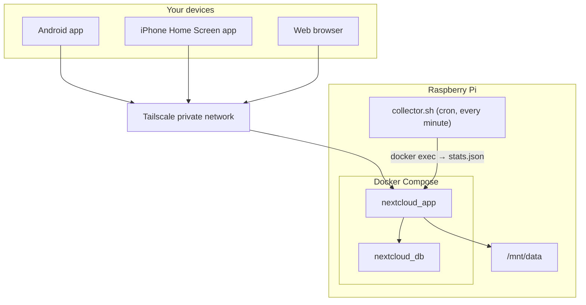

# My Pi Cloud

A personal cloud you run on a Raspberry Pi: Nextcloud for files, a small custom app with a home dashboard and an iPhone-friendly web app, a host stats collector, and an Android client. You reach it from anywhere over a free [Tailscale](https://tailscale.com) network — no open router ports, no paid domain required.

This repository is the complete kit. It is written so someone starting from a bare Pi can follow it end to end.

## What you get

- **Nextcloud** in Docker, with your files on a USB drive.
- **`poojithhome`**, a Nextcloud app that adds:
  - a **My Cloud** Dashboard widget (storage bar, new folder, upload, root folders, and a System card);
  - a **mobile web app** at `/apps/poojithhome/` you can add to an iPhone home screen.
- A **stats collector** (a user crontab, no sudo) that records network use, CPU temperature, throttling, an estimated power draw, and Nextcloud disk usage.
- An **Android app** (package `com.example.picloud`, name **My Pi Cloud**) with a first-run server URL screen, official Nextcloud Login Flow v2, the same storage and System cards, and a file manager.

## Architecture



Traffic stays on your Tailscale overlay (or your LAN). The collector runs as a normal user and writes `stats.json` into Nextcloud's data directory; the app and Android client read it from `/apps/poojithhome/stats`.

## Hardware

| Item | Notes |
| --- | --- |
| Raspberry Pi 4 | 4 GB RAM is comfortable; 8 GB is nicer. A Pi 5 works too. |
| Official or quality USB-C power supply | 5 V / 3 A or better. Hungry USB disks need **their own** power. |
| microSD card, 32 GB or larger | For the operating system only, not your files. |
| USB hard drive or SSD | Nextcloud data. A second drive for backups is optional but wise. |
| Powered USB hub or dock | Required for most 3.5″ HDDs; the Pi cannot power them reliably. |
| Ethernet (preferred) or Wi-Fi | Ethernet is more stable for a server. |

## 1. Flash Raspberry Pi OS

1. On a laptop, install [Raspberry Pi Imager](https://www.raspberrypi.com/software/).
2. Choose **Raspberry Pi OS (64-bit)**.
3. In Imager's settings (the gear icon), set a hostname, a username and password, your Wi-Fi if you will not use Ethernet, and **enable SSH** (use public-key authentication if you can).
4. Write the image, put the card in the Pi, and power it on. Wait a couple of minutes for first boot.

## 2. SSH in, find the IP, reserve it

From your laptop:

```bash
ssh <USER>@<PI_LAN_IP>
# if mDNS works on your network you can try:
ssh <USER>@<HOSTNAME>.local
```

Once, copy your SSH key so you do not have to type the password:

```bash
ssh-copy-id <USER>@<PI_LAN_IP>
```

On the Pi, confirm the address:

```bash
hostname -I
ip -br addr
```

In your router's DHCP settings, **reserve that LAN IP** (`<PI_LAN_IP>`) for the Pi's MAC address so it does not change after a reboot.

## 3. Format and mount the data drives

**This erases the drive.** Double-check the device name before you format.

```bash
# See disks, partitions, current UUIDs and mount points
lsblk -o NAME,SIZE,MODEL,FSTYPE,UUID,MOUNTPOINT
sudo blkid
```

Create a filesystem (example: the data disk is `/dev/sda1` — use *your* device):

```bash
sudo mkfs.ext4 -L cloud-data /dev/sda1
# optional second disk:
# sudo mkfs.ext4 -L cloud-backup /dev/sdb1
sudo blkid
```

Mount by **UUID**, not by `/dev/sdX` (those letters can swap after a reboot):

```bash
sudo mkdir -p /mnt/data /mnt/backup
sudo cp /etc/fstab /etc/fstab.bak
# Add a line like this for each disk, using the UUID from blkid:
# UUID=<DATA_DISK_UUID>    /mnt/data    ext4  defaults,nofail,x-systemd.device-timeout=30  0  2
# UUID=<BACKUP_DISK_UUID>  /mnt/backup  ext4  defaults,nofail,x-systemd.device-timeout=30  0  2
sudo nano /etc/fstab
sudo systemctl daemon-reload
sudo mount -a
df -h /mnt/data
```

`nofail` lets the Pi boot even if a drive is unplugged. If `mount -a` errors, the UUID in `fstab` does not match `blkid`.

Create the directories the Compose file bind-mounts:

```bash
mkdir -p /mnt/data/nextcloud /mnt/data/mariadb
# Nextcloud runs as www-data (uid 33) in the official image:
sudo chown -R 33:33 /mnt/data/nextcloud
```

## 4. Install Docker and Compose

On the Pi, follow Docker's Debian instructions or:

```bash
curl -fsSL https://get.docker.com | sh
sudo usermod -aG docker "$USER"
```

Log out and back in (or reboot) so the group applies, then check:

```bash
docker version
docker compose version
```

You should be able to run `docker` **without** sudo.

## 5. Start Nextcloud

Copy the `docker/` folder from this repository to the Pi, for example to `~/nextcloud`. From your laptop:

```bash
scp -r docker <USER>@<PI_LAN_IP>:~/nextcloud
ssh <USER>@<PI_LAN_IP>
cd ~/nextcloud
cp .env.example .env
nano .env   # set long random MYSQL_/MARIADB_ passwords; the user/password pairs must match
docker compose up -d
docker compose ps
```

Wait until `nextcloud_app` is healthy (the first pull and setup can take a few minutes). Then open:

```text
http://<PI_LAN_IP>:8080
```

If you did not set `NEXTCLOUD_ADMIN_USER` in `.env`, create the admin account in the browser. The database host is `nextcloud_db`, and the database name, user and password are the values you put in `.env`.

## 6. trusted_domains, overwrite.cli.url, data directory

The Compose file already bind-mounts `/mnt/data/nextcloud` onto Nextcloud's default data path, `/var/www/html/data`. You normally **do not** need to change `datadirectory`. If you prefer a different layout, set it explicitly:

```bash
docker exec -u www-data nextcloud_app php occ config:system:get datadirectory
# only if you use a custom path, for example /data/nextcloud:
# docker exec -u www-data nextcloud_app php occ config:system:set datadirectory --value=/data/nextcloud
```

Tell Nextcloud which addresses are allowed (no `http://`, space-separated if you use the env var). At minimum add the LAN IP and, once you have it, the Tailscale IP:

```bash
docker exec -u www-data nextcloud_app php occ config:system:set trusted_domains 0 --value=localhost
docker exec -u www-data nextcloud_app php occ config:system:set trusted_domains 1 --value=<PI_LAN_IP>
docker exec -u www-data nextcloud_app php occ config:system:set trusted_domains 2 --value=<PI_TAILSCALE_IP>
```

Set the canonical URL that Login Flow v2 and generated links should use. Prefer the Tailscale address once Tailscale is up, including the port:

```bash
docker exec -u www-data nextcloud_app php occ config:system:set overwrite.cli.url --value=http://<PI_TAILSCALE_IP>:8080
docker exec -u www-data nextcloud_app php occ config:system:set overwritehost --value=<PI_TAILSCALE_IP>:8080
docker exec -u www-data nextcloud_app php occ config:system:set overwriteprotocol --value=http
```

If these are wrong, the Android login page may bounce to a hostname the phone cannot reach.

## 7. Tailscale (free remote access)

On the Pi:

```bash
curl -fsSL https://tailscale.com/install.sh | sh
sudo tailscale up
```

Open the login URL it prints, sign in (the free personal plan is enough), and note the address:

```bash
tailscale ip -4
# this is <PI_TAILSCALE_IP>, typically in 100.64.0.0/10
```

Add that address to `trusted_domains` (step 6) if you did not already.

On every phone, tablet and laptop that should reach the cloud, install the Tailscale app and sign in with the **same** account. Then open:

```text
http://<PI_TAILSCALE_IP>:8080
```

The session is encrypted by Tailscale even though Nextcloud itself is serving plain HTTP. Do not open port 8080 on your router.

## 8. Install the custom Nextcloud app

From your laptop, copy the app onto the Pi and enable it. After a version change you must also run `occ upgrade`.

```bash
scp -r nextcloud-app/poojithhome <USER>@<PI_LAN_IP>:~/poojithhome
ssh <USER>@<PI_LAN_IP> 'set -e
docker exec nextcloud_app rm -rf /var/www/html/custom_apps/poojithhome
docker cp ~/poojithhome nextcloud_app:/var/www/html/custom_apps/
docker exec nextcloud_app chown -R www-data:www-data /var/www/html/custom_apps/poojithhome
docker exec -u www-data nextcloud_app php occ upgrade
docker exec -u www-data nextcloud_app php occ app:enable poojithhome
docker exec -u www-data nextcloud_app php occ app:list | grep poojithhome
'
```

If `occ app:enable` says the app is not found, your image may not include `custom_apps` in `apps_paths`. Check with:

```bash
docker exec -u www-data nextcloud_app php occ config:system:get apps_paths
```

and copy the app into whichever directory is marked writable, or add `custom_apps` there.

Open Nextcloud in a browser → **Dashboard** → **Customize** and enable **My Cloud**.

## 9. Install the stats collector cron

The collector reads host network and CPU data, and once an hour measures Nextcloud disk and database size. It writes JSON into the data directory with `docker exec` (your user must be in the `docker` group). It does **not** need sudo.

```bash
scp stats-collector/collector.sh stats-collector/crontab.example <USER>@<PI_LAN_IP>:~
ssh <USER>@<PI_LAN_IP> 'set -e
mkdir -p ~/cloud-stats
mv ~/collector.sh ~/cloud-stats/
chmod +x ~/cloud-stats/collector.sh
# Run twice so counters have a baseline (the first run records zeros).
~/cloud-stats/collector.sh
sleep 5
~/cloud-stats/collector.sh
# Confirm JSON landed both on the host and in the container data dir
python3 -m json.tool ~/cloud-stats/stats.json | head
docker exec -u www-data nextcloud_app test -f /var/www/html/data/stats.json && echo "container stats.json: ok"
(crontab -l 2>/dev/null | grep -v cloud-stats/collector.sh; echo "* * * * * \$HOME/cloud-stats/collector.sh >>\$HOME/cloud-stats/collector.log 2>&1") | crontab -
crontab -l
'
```

If you changed `datadirectory` away from `/var/www/html/data`, prefix the cron line with `NC_DATADIR=/your/path`.

Throttling status comes from `vcgencmd get_throttled`. That works without sudo when your user is in the `video` group:

```bash
groups
# if "video" is missing and you have a one-time sudo:
# sudo usermod -aG video "$USER"
# then log out and back in
```

If `vcgencmd` is missing or the group is not set, the System card shows "throttling status unavailable" and everything else still works.

## 10. Build and sideload the Android app

The first launch asks for your server URL (leave it empty until you type one, for example `http://<PI_TAILSCALE_IP>:8080`). Sign-in uses Nextcloud Login Flow v2. Storage, the System card and the file manager then talk to that server with the app password Login Flow issues.

### Android Studio

1. Open the `android/` folder as a project.
2. Let it install the Android SDK (compile / target SDK 34, min 24, JDK 17+).
3. If `local.properties` is not created automatically, copy `local.properties.example` and set `sdk.dir`.
4. Build → Build Bundle(s) / APK(s) → **Build APK(s)**.
5. Copy `app/build/outputs/apk/debug/app-debug.apk` to the phone and install it (allow “Install unknown apps” for Files or Chrome). Play Protect may warn; you can dismiss it for a sideload you built yourself.

### Command line

```bash
cd android
cp local.properties.example local.properties
# edit sdk.dir
./gradlew assembleDebug    # or: gradle assembleDebug
# APK: app/build/outputs/apk/debug/app-debug.apk
```

Debug builds are signed with the local Android debug keystore (`~/.android/debug.keystore`). Keep using the same keystore if you want later builds to install as updates.

### Changing the package or app name

The shipped identity is **My Pi Cloud** / `com.example.picloud`. To rebrand it:

1. Change `namespace` and `applicationId` in `android/app/build.gradle`.
2. Change `app_name` in `android/app/src/main/res/values/strings.xml`.
3. Update the `FileProvider` authority in `AndroidManifest.xml` (`com.example.picloud.files`) and the matching `getUriForFile(...)` call in `MainActivity.java`.
4. Move `java/com/example/picloud/` to match the new package and update the `package` line in each `.java` file.

A new `applicationId` is a different app as far as Android is concerned; it will not upgrade over an install that used the old id.

## 11. iPhone home-screen web app

There is no App Store binary in this repository. The Nextcloud app serves a mobile-first page you can install from Safari.

1. On the iPhone, connect Tailscale.
2. In **Safari** (not Chrome), open:

   ```text
   http://<PI_TAILSCALE_IP>:8080/index.php/apps/poojithhome/
   ```

3. Sign in if Nextcloud asks.
4. Share → **Add to Home Screen**. The name is **My Cloud**.

The page uses `apple-mobile-web-app-capable`, a 180 px touch icon, a theme color and a web manifest with `display: standalone`. The site is plain HTTP over Tailscale, so **iOS will not register a service worker** — the app needs a network and will not work offline. The first launch of the home-screen icon has its own cookie jar, so you may have to sign in once more.

## 12. Optional: Jellyfin for TV streaming

Not set up in this repository, but straightforward later. [Jellyfin](https://jellyfin.org) can run as another Compose service on the same Pi, with a library folder on `/mnt/data`. Official Jellyfin apps exist for **Android TV** and **Apple TV**, so you can stream videos you already store in Nextcloud (or a dedicated media folder) to a TV. Give Tailscale access the same way as Nextcloud, and do not open extra ports on the router.

## Troubleshooting

**“Access through untrusted domain”**  
Add the exact host you typed (LAN IP, Tailscale IP, or hostname, without `http://`) to `trusted_domains` as in step 6, then retry.

**“Update needed” / maintenance screen after replacing the app**  
Nextcloud noticed a new `poojithhome` version. Run:

```bash
docker exec -u www-data nextcloud_app php occ upgrade
docker exec -u www-data nextcloud_app php occ maintenance:mode --off
docker exec -u www-data nextcloud_app php occ app:enable poojithhome
```

**Drives not mounting**  
- Compare `UUID=` in `/etc/fstab` with `sudo blkid`. Letters like `sda` can change; UUIDs should not.
- Check power: an unpowered or underpowered HDD will disappear or drop off. Use a powered hub, look at `dmesg -T | tail` for USB resets.
- `nofail` means the Pi still boots — `df -h` is the check, not “it booted.”

**The Pi’s IP changed**  
Reserve `<PI_LAN_IP>` in DHCP. If it already changed, update `trusted_domains`, `overwrite.cli.url`, bookmarks, and the Android server URL (menu → Change server). Tailscale IPs are usually stable for a given machine and account.

**Android Login Flow opens a page that never finishes / wrong host**  
`overwrite.cli.url` (and usually `overwritehost` / `overwriteprotocol`) must match the address the phone can actually open, typically `http://<PI_TAILSCALE_IP>:8080`. The app rewrites login URLs back onto the server you typed, but a path prefix or `https` forced by Nextcloud will still break sign-in.

**System card: “No stats yet”**  
The collector is not running, cannot `docker exec`, or is writing to the wrong `NC_DATADIR`. Check `~/cloud-stats/collector.log`, `crontab -l`, and that `stats.json` exists in the data directory inside the container.

**`occ app:enable` fails with a version error**  
`poojithhome` declares Nextcloud `min-version=28` and `max-version=34`. For a newer server, bump `max-version` in `appinfo/info.xml` or use `occ app:enable --force poojithhome` at your own risk.

**Uploads fail on large files**  
The Android app and the web app send a single PUT (no chunking). PHP and Nextcloud upload limits apply; raise them in the official image if you need bigger files.

## Security notes

- **Do not port-forward 8080** (or 80/443) on your router. Tailscale is the remote-access path this project is designed for.
- Nextcloud is served over **plain HTTP**. That is acceptable only because Tailscale (or your LAN) already encrypts the path. If you ever publish this host on the public internet, put a TLS reverse proxy in front and turn `overwriteprotocol` to `https`.
- The Android app permits cleartext HTTP app-wide. Android cannot allowlist an IP *range* (Tailscale’s `100.64.0.0/10` or a LAN) in `networkSecurityConfig`, so a base-config exception is used. Treat the app as a private-cloud client, not a general browser.
- Change every placeholder password in `.env`. Never commit `.env`.
- Login Flow v2 issues an **app password**. Revoke it in Nextcloud (Settings → Security) if a device is lost.
- Membership of the `docker` group is effectively root on that machine. Only use an account you trust.
- Keep Raspberry Pi OS, Docker images (`docker compose pull && docker compose up -d`) and Nextcloud (`occ update` / the admin overview) current.
- Power numbers on the System card are **estimates** (a simple watt model), not metered kWh.

## Layout of this repository

```text
android/                  My Pi Cloud Android client (Gradle, SDK 34)
nextcloud-app/poojithhome Custom Nextcloud app (dashboard, /stats, mobile PWA)
stats-collector/          collector.sh + crontab.example
docker/                   docker-compose.yml + .env.example
README.md                 this guide
LICENSE                   MIT, 2026 Poojith Malla (see note below)
```

The Nextcloud app in `nextcloud-app/poojithhome` is licensed under the **GNU AGPL v3** (required for Nextcloud apps). Everything else in this repository is **MIT**.

## License

MIT © 2026 Poojith Malla, except `nextcloud-app/poojithhome` (AGPL-3.0). See `LICENSE` and `nextcloud-app/LICENSE`.
